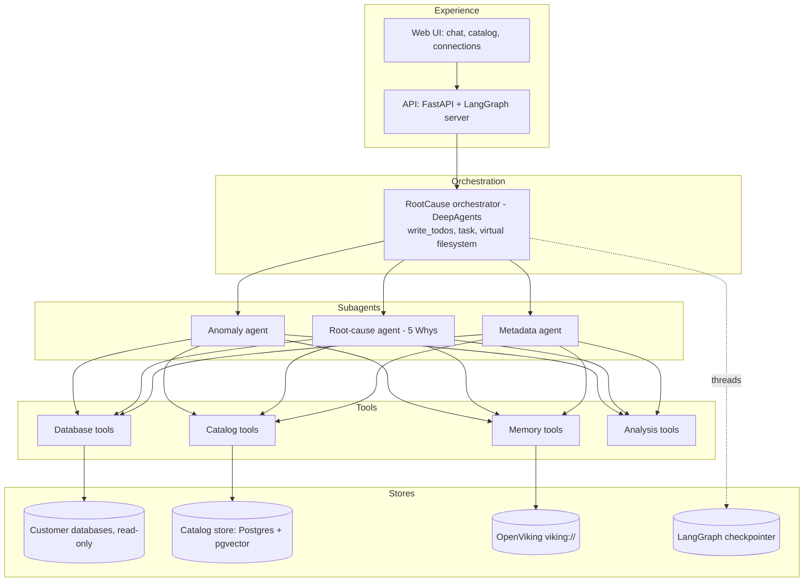

# RootCause Agent System — Technical PRD

As of 2026-10-24. Living version of this document: https://claude.ai/artifact/CwPHDcFKQf5vnBrowK54NB

## 1. Overview and goals

RootCause is a multi-agent system that answers "why did this metric move?" against a customer's own database, and gets better at it with every investigation. A LangChain DeepAgents orchestrator delegates to an anomaly-detection agent, a 5 Whys root-cause agent and a metadata agent; all of them read a shared semantic catalog of the database and write what they learn into an OpenViking context store.

**Goals**

1. Detect: find anomalies in business data (time series, segments, counts, rates) on a connected SQL database without hand-written queries.
2. Explain: trace each anomaly to an actionable root cause with an evidence-backed why-chain, not a restated symptom.
3. Ground: every claim links to a query and a result set that a human can re-run.
4. Learn: each solved case becomes a reusable lesson or skill that shortens the next similar investigation.
5. Operate: analysts manage connections, the metadata catalog and conversations from one web UI.

**Non-goals (v1)**

- Writing to customer databases. All connections are read-only.
- Real-time streaming anomaly detection. v1 works on batch and on-demand queries.
- Replacing a BI tool. Charts are supporting evidence, not dashboards.
- Code-level debugging of application software. The target is data and business process causes.

**Success metrics**

| Metric | Target for v1 |
| --- | --- |
| Root-cause acceptance rate (analyst marks the conclusion correct) | 70% of investigations |
| Median time from question to validated why-chain | under 10 minutes |
| Share of why-chain steps backed by an executed query | 100% |
| Investigations that reuse at least one stored lesson | 40% after 50 solved cases |
| SQL generation error rate (queries that fail or return wrong grain) | under 5% |

## 2. Users and core stories

| Role | Needs | Primary surface |
| --- | --- | --- |
| Business or data analyst | Ask why a KPI changed, see evidence, accept or reject the conclusion | Chat UI |
| Data engineer | Register databases, run metadata indexing, fix joins and column descriptions | Metadata and database management UI |
| Platform admin | Manage credentials, model keys, memory retention, access per team | Settings UI, config files |

**Core user stories**

1. As an analyst I type "orders dropped 18% last Tuesday, why?" and get a why-chain where every step shows the SQL and the numbers behind it.
2. As an analyst I ask "scan the sales schema for anything unusual in the last 30 days" and get a ranked list of anomalies with severity, affected segment and a one-line hypothesis each.
3. As an analyst I click "investigate" on an anomaly and the root-cause agent takes over with that anomaly as the problem statement.
4. As an analyst I mark a conclusion correct or wrong and add a note. The system stores the case as a lesson and uses it next time.
5. As a data engineer I add a Postgres connection, trigger indexing, and review the discovered tables, columns, categorical values and join candidates before analysts use them.
6. As a data engineer I correct a wrong join or add a business definition ("active customer = order in last 90 days") and the agents use it from then on.
7. As an admin I see every query the agents executed, with duration and row counts, and can set row and time limits per connection.
8. As an analyst I see which stored lessons and skills influenced an answer and can open them.

## 3. System architecture

The system is one DeepAgents orchestrator with three specialised subagents, a shared tool layer and four stores. The orchestrator never queries a database itself. It plans, delegates, and merges the subagents' reports into the final answer.



**Why DeepAgents.** The harness gives the four things a long investigation needs without custom graph code: a planning tool (`write_todos`), a virtual filesystem for working notes and large query results, a `task` tool that spawns isolated subagents returning a compressed report, and backends that decide which files persist. It also loads Agent Skills (SKILL.md) with progressive disclosure, which is how stored lessons re-enter an investigation.

**Component responsibilities**

| Component | Owns | Does not own |
| --- | --- | --- |
| Orchestrator | Problem framing, plan, delegation order, final narrative, asking the user for clarification | SQL, statistics |
| Anomaly agent | Metric discovery, detection runs, ranking, anomaly records | Explaining causes |
| Root-cause agent | Why-chain, hypothesis tests, validation, countermeasures | Finding new anomalies |
| Metadata agent | Question-to-SQL, join resolution, value lookup, query repair | Interpreting results |
| Catalog service | Indexing jobs, schema and value index, join graph, business glossary | Executing analysis queries |
| Memory service | OpenViking sessions, lesson extraction, skill promotion, retrieval | Agent prompts |

**Investigation flow for "why did X change?"**

1. Orchestrator writes the problem statement in the 5 Whys template (what, when, where, impact) and a todo plan. It queries memory for similar past cases and loads matching skills.
2. Orchestrator delegates to the metadata agent to confirm the metric definition, the table, the grain and the time column.
3. Orchestrator delegates to the anomaly agent to confirm the change is real, bound its window, and decompose it by available dimensions.
4. Orchestrator delegates to the root-cause agent with the anomaly record and the segment decomposition. The agent iterates why-questions, each answered by a query.
5. The root-cause agent validates the chain backwards and proposes countermeasures. The orchestrator writes the final report with linked evidence.
6. The user accepts, rejects or edits. The memory service commits the session to OpenViking and extracts a lesson. Repeated lessons are promoted to a skill.

**Subagent configuration.** Each subagent is a DeepAgents SubAgent with its own name, description, system prompt, tool subset and model. Anomaly and metadata agents use a fast model (Claude Sonnet 5); the root-cause agent uses a stronger reasoning model (Claude Opus 5 or Fable 5.1). Subagents run in isolated mode. The orchestrator uses a CompositeBackend: `/memories/` and `/skills/` route to a persistent StoreBackend, everything else is per-thread state. `interrupt_on` is set for `run_sql` when the planner estimates a scan over a configurable row threshold.

**Context engineering rules**

- Query results above 200 rows go to the virtual filesystem and are summarised; the agent reads slices.
- Each subagent returns a structured report (Pydantic model) plus a human summary.
- Catalog lookups return L0 one-line summaries first and full detail on request, mirroring OpenViking's tiers.

## 4. Root-cause subagent (5 Whys)

A DeepAgents subagent whose system prompt and skill are a port of https://github.com/awesome-skills/5-whys-skill/blob/main/SKILL.md, adapted so every "why" is answered by a database query rather than reasoning alone.

**Inputs**

- Problem statement in the skill's template: what, when, where, impact. Vague statements are sent back to the user for quantification.
- Anomaly record: metric, grain, baseline window, anomaly window, effect size, top contributing segments.
- Metric definition and candidate tables from the catalog.
- Related lessons and skills from OpenViking.

**Process, mapped from the skill's five phases**

1. Define the problem with numbers. If the anomaly record disagrees with the user's claim, surface that first.
2. Iterate why-questions. Per level, generate 2 to 4 candidate causes, rank, test the top ones with queries. Keep a candidate only if a query supports it. Branch when more than one survives.
3. Identify the root cause. Stop when a cause is actionable, preventable, fundamental and verifiable, or maps to a stop condition: process or policy change, missing control, data pipeline defect, design flaw, external event.
4. Validate backwards with counterfactual checks: exclude the suspected segment or event and confirm the anomaly disappears or shrinks proportionally.
5. Define countermeasures: immediate, preventive, detection. Detection mechanisms become candidate monitors for the anomaly agent.

**Hypothesis sources, in priority order:** stored lessons for the metric or schema; segment decomposition; data quality checks (null spikes, duplicates, late data, schema changes); related metrics in the catalog's metric graph; known events (deployments, price changes, campaigns, holidays).

**Tools**

| Tool | Purpose |
| --- | --- |
| `ask_sql(question, context)` | Question-to-SQL via the metadata agent's tool set; returns rows plus SQL |
| `run_sql(sql)` | Executes a written query, read-only, with limits |
| `compare_windows(metric, dims, baseline, anomaly)` | Per-dimension contribution to the change |
| `data_quality_probe(table, window)` | Null rate, row count, duplicate key and freshness checks |
| `recall_lessons(query)` | OpenViking search over past cases and lessons |
| `write_todos`, filesystem tools | Track branches and intermediate results |

**Output contract**

```
WhyChain
  problem: {what, when, where, impact}
  levels: [ {question, answer, evidence: [{sql, rows_summary, chart_ref}], confidence} ]
  branches: [WhyChain]
  root_cause: {statement, type: process|design|data|external|knowledge, confidence}
  validation: [{link, check_sql, passed}]
  countermeasures: [{type: immediate|preventive|detection, action, owner?}]
  lessons_candidate: {trigger, pattern, resolution}
```

**Guardrails from the skill's pitfalls**

- Stopping too early: restating the problem at a different grain is not a cause; a mechanism is required.
- Blame instead of cause: name processes, pipelines or decisions, never individuals.
- Multiple causes: when two candidates each explain more than 25% of the delta, open a branch for each.
- Unverified assumptions: a level with no passing evidence is a hypothesis and cannot be the root cause.
- Depth: at least 3 levels, at most 7. Five is a default, not a rule.

**Acceptance criteria:** every level has at least one executed query; validation passes for every link or the report says which failed; the agent returns within a budget (default 25 tool calls, 8 minutes) and reports partial chains honestly.

## 5. Anomaly detection agent

Turns "anything unusual?" or "did orders really drop?" into ranked, reproducible anomaly records. Aggregation happens in SQL; detection runs in Python on aggregates only.

**Modes**

| Mode | Trigger | Output |
| --- | --- | --- |
| Confirm | A user claim about one metric | One anomaly record with effect size, window, segment decomposition, or a finding that the claim does not hold |
| Scan | Scan a schema, table or metric set over a window | Ranked, deduplicated list of anomaly records |

**Pipeline:** metric discovery from the catalog; grain-correct aggregation in SQL; detection via skills; decomposition by dimension; ranking and dedup by cause signature; persist `AnomalyRecord` plus a chart spec.

**Detection skills**

| Skill | Technique | Applies to | Library |
| --- | --- | --- | --- |
| `ts_robust_zscore` | Rolling median and MAD z-score with seasonal baseline | Daily and hourly series with 4+ weeks history | pandas, numpy |
| `ts_stl_residual` | STL decomposition, residual thresholding | Weekly or yearly seasonality | statsmodels |
| `ts_changepoint` | PELT or binary segmentation on mean and variance | Level shifts, regime changes | ruptures |
| `ts_forecast_interval` | ETS or Prophet-style forecast, flag points outside interval | Longer series with trend | statsforecast or Prophet |
| `segment_contribution` | Delta decomposition by dimension, Simpson's paradox check | Any anomaly with dimensions | pandas |
| `distribution_shift` | PSI and KS tests between windows | Categorical and numeric distributions | scipy |
| `data_quality_anomaly` | Row count, null rate, duplicate key, freshness deviations | Every table in a scan | SQL only |
| `multivariate_outlier` | Isolation Forest on entity-level features | Entity anomalies (customers, stores, SKUs) | scikit-learn |

Ensemble rule: an anomaly needs agreement from two applicable skills, or one with very high confidence. Each skill records its parameters so runs are reproducible.

**Tools:** `list_metrics(scope)`, `aggregate_series(metric, grain, dims, window)`, `detect(series_handle, skills)`, `decompose(metric, baseline, anomaly, dims)`, `save_anomaly(record)`.

**AnomalyRecord fields:** id, connection, metric definition, grain, dimension filters, baseline window, anomaly window, observed vs expected, effect size, direction, confidence, techniques fired with parameters, top contributing segments, data quality flags, SQL used, created at.

**Non-functional:** a 50-table scan on 100M-row tables completes within 15 minutes, mostly in SQL; no raw rows leave the database for detection; thresholds per connection, editable in the UI; every anomaly re-runs identically from its record.

## 6. Database connection and retrieval tools

All database access goes through one connection service with a small, audited tool surface. Agents never see credentials and never run write statements.

**Connection service**

- Postgres, MySQL, SQL Server, Snowflake, BigQuery, ClickHouse, DuckDB via SQLAlchemy dialects, plus generic SQLAlchemy URL. Postgres and DuckDB are the reference test targets.
- Credentials encrypted at rest (Fernet key from a secrets backend). Agents get a connection id only.
- Read-only role where supported, and the service rejects anything that is not a single SELECT or WITH.
- Per-connection limits: statement timeout (60 s default), max rows (10,000 default), max bytes scanned where reported, concurrency cap.
- Pooling per connection, health check on registration and on a schedule.

**Tool surface**

| Tool | Returns | Notes |
| --- | --- | --- |
| `list_connections()` | Connection ids, dialects, names | Filtered by user access |
| `list_schemas(connection)` | Schemas with table counts | information_schema or equivalent |
| `list_tables(connection, schema)` | Tables, row estimates, last modified | Estimates from catalog statistics |
| `describe_table(connection, table)` | Columns, types, keys, indexes, comments | Merged with catalog enrichments |
| `sample_rows(connection, table, n<=50)` | Sampled rows | TABLESAMPLE where supported |
| `column_profile(connection, table, column)` | Distinct count, null rate, min, max, top values | Cached in the catalog |
| `run_sql(connection, sql, purpose)` | Rows, types, count, duration, truncated flag | Large results return a filesystem handle |
| `explain_sql(connection, sql)` | Plan summary and cost | Drives `interrupt_on` |
| `validate_sql(connection, sql)` | Parse result, referenced objects, warnings | sqlglot based |

**Execution rules:** parse and transpile with sqlglot and check the allow list; inject LIMIT when absent on non-aggregates; write every query to the audit log (SQL, purpose, agent, thread, duration, rows, error); short-lived result cache per thread; Arrow internally, compact JSON to the model.

**Error handling:** structured error codes (unknown column, timeout, permission, syntax) so the metadata agent repairs rather than retries; after three failed repairs the failure is reported upward.

## 7. Metadata management system

The catalog is the semantic layer every agent queries before writing SQL, and the single place humans correct what the agents believe about the data.

**What is indexed**

| Object | Captured | Source |
| --- | --- | --- |
| Table | Name, schema, row estimate, freshness, description, domain, importance score, time column candidates | information_schema, sampling, LLM enrichment, human edits |
| Column | Type, nullability, semantic type (id, timestamp, money, category, flag, text, geo), description, unit, cardinality, null rate, min/max | Profiling, LLM enrichment, human edits |
| Categorical entity | Distinct values with frequencies (cardinality under 500 by default), synonyms, labels | Profiling, LLM naming, human edits |
| Join | Foreign keys, inferred joins (name match plus value overlap), cardinality, confidence, approved flag | Constraints, inference job, human edits |
| Metric | Name, SQL expression, grain, filters, owning table, dimensions, business weight | Human definitions, LLM proposals |
| Glossary term | Business definition mapped to columns, values or metrics | Human edits, accepted investigations |
| Event | Dated business events (releases, campaigns, price changes, outages) | Manual entry, CSV import, events table |

**Indexing pipeline:** structural crawl (incremental, diffed; schema changes become events) → profiling with cost caps and approximate distincts → join inference (heuristics, type compatibility, inclusion test; low confidence awaits approval) → LLM enrichment marked machine-generated until confirmed → embedding into pgvector for hybrid search → publish a catalog version.

**Retrieval API:** `search_catalog(query, kinds, connection, k)` (hybrid, returns L0 summaries), `get_table_context(table_ids)` (prompt block for SQL generation), `resolve_value(text, connection)`, `find_join_path(a, b)`, `get_metric(name)`, `propose_enrichment(object, field, value, evidence)`.

**Storage:** Postgres with pgvector, separate from any customer database; versions, pending edits, audit trail; JSON export and import.

**Human workflow:** review queue for machine-generated descriptions and inferred joins, inline editing, bulk approve, version diff. Every edit becomes an OpenViking memory so agents learn the correction.

**Acceptance:** 200-table Postgres indexes structure in under 5 minutes and profiles in under 30 minutes with default caps; `search_catalog` top-3 accuracy 90% on a held-out question set; inferred join precision above 90% at the default threshold.

## 8. OpenViking memory layer

OpenViking (https://github.com/volcengine/OpenViking) is the long-term memory for every agent: memories, resources and skills as one virtual filesystem under `viking://`, served in three tiers (L0 abstract, L1 overview, L2 detail), with memory extraction on session commit.

**Deployment:** server mode in Docker beside the API (AGPLv3 server run unmodified as a separate service; Python client from our code). Embedding provider configurable; OpenAI-compatible by default, Ollama for air-gapped installs. Pinned at 0.3.x at project start.

**Namespace layout**

```
viking://
  resources/connections/{connection_id}/catalog-snapshot/
  resources/connections/{connection_id}/events/
  user/{user_id}/memories/preferences/
  user/{user_id}/memories/cases/
  agent/orchestrator/memories/cases/{case_id}.md
  agent/orchestrator/memories/lessons/{lesson_id}.md
  agent/orchestrator/skills/{skill_name}/SKILL.md
  agent/anomaly/memories/lessons/      agent/anomaly/skills/
  agent/rootcause/memories/lessons/    agent/rootcause/skills/
  agent/metadata/memories/lessons/
```

**Memory types**

| Type | Example | Written by | Read by |
| --- | --- | --- | --- |
| Case | "2026-10-14 orders drop, root cause: payment provider timeout in DE, accepted" | Memory service on commit | Orchestrator, root-cause agent |
| Lesson | "When orders fall and sessions are flat, check payment success rate by provider before traffic" | Lesson extractor | Root-cause agent |
| Catalog correction | "orders.cust_ref joins customers.id, not customers.external_id" | Catalog UI edit hook | Metadata agent |
| Detection note | "revenue has a monthly close spike on the last business day" | Anomaly agent after a dismissal | Anomaly agent |
| Preference | "this user wants weekly grain and short answers" | OpenViking extraction | Orchestrator |
| Skill | SKILL.md with steps, SQL templates, stop conditions | Skill promoter | DeepAgents skill loader |

**Lesson lifecycle:** commit session (transcript, WhyChain, anomaly records, verdict) → extract lesson (trigger, hypothesis order that worked, decisive queries, resolution; rejected cases yield negative lessons) → deduplicate (near-duplicates increment a support counter) → promote to SKILL.md after three supporting cases or a human playbook flag, versioned with case ids → archive lessons unused for 180 days.

**Retrieval:** orchestrator searches at framing (L0 first, L1 for top five, L2 only when used); root-cause agent uses scoped `find` by metric and schema; metadata agent reads corrections before first SQL on a table; every memory used is cited in the report.

**DeepAgents integration:** tools (`recall_lessons`, `search_memory`, `commit_session`) plus a custom backend mounted at `/memories/` in the CompositeBackend; skills synced from `viking://agent/*/skills/` to the harness skill directory on promotion.

**Governance:** memories scoped per tenant and connection; users can view, edit, delete memories about them; admins can retire skills; memories hold SQL and aggregates, never raw rows with personal data.

## 9. User interface

One web app with three areas, built with Next.js and the LangGraph SDK for streaming; FastAPI mounted beside LangGraph Server.

**Investigate (chat):** streamed orchestrator messages, todo state and subagent steps; tool calls show SQL, duration, rows; evidence panel with why-chain tree, anomaly charts, result tables; anomaly feed cards with "Investigate"; verdict controls (accept, reject, partial, note); "what informed this" drawer; approval prompts for expensive queries; thread list with search and sharing.

**Catalog:** schema browser with semantic badges; table and column pages with stats, values, synonyms, joins; join graph view with inline approve/reject; metrics and glossary editors with SQL preview; events editor and CSV import; review queue and version diff; indexing controls with job logs.

**Connections:** dialect-specific forms, test connection, read-only verification (refuses writable roles); per-connection limits; query audit log with filter and export; health view.

**Settings and admin:** models per agent role, API keys, OpenViking endpoint, embedding provider; users and roles with per-connection access; memory management (browse viking://, delete, retire skills, retention).

**UX requirements:** first token within 3 s; progress from the todo list, not a spinner; every number clickable to its query; 1280 px and above, mobile read-only.

## 10. Tech stack, repo layout, non-functional requirements

| Layer | Choice |
| --- | --- |
| Agents | `deepagents`, `langchain`, `langgraph`, Python 3.12, `uv` |
| Models | Claude Sonnet 5 (anomaly, metadata), Claude Opus 5 or Fable 5.1 (root cause, lesson extraction), via `init_chat_model` |
| API | FastAPI beside LangGraph Server; checkpointer and store on Postgres |
| DB access | SQLAlchemy 2, dialect drivers, `sqlglot`, `pyarrow` |
| Analysis | `pandas`, `numpy`, `scipy`, `statsmodels`, `ruptures`, `scikit-learn`, `statsforecast` |
| Catalog store | Postgres 16 + `pgvector`, hybrid search |
| Memory | OpenViking server in Docker, Python client |
| UI | Next.js 15, React, LangGraph JS SDK, Tailwind, Recharts |
| Observability | LangSmith (optional), OpenTelemetry, structured logs |
| Quality | `pytest`, `ruff`, `mypy`, Playwright, golden-case evaluation suite |

```
rootcause/
  apps/api/            # FastAPI app, LangGraph server config, auth
  apps/web/            # Next.js UI
  packages/agents/     # orchestrator, subagents, prompts, skills/
  packages/tools/      # db, catalog, memory, analysis tools
  packages/catalog/    # indexing jobs, models, search
  packages/connections/# connection service, dialects, validation, audit
  packages/anomaly/    # detection skills, decomposition, records
  packages/memory/     # OpenViking client, lesson extractor, skill promoter
  packages/evals/      # seeded demo databases, golden cases, scoring
  docs/                # PRD, ADRs, runbooks
  deploy/              # docker-compose, env templates
```

**Evaluation suite:** a synthetic manufacturing warehouse seeded with 20 scripted incidents at three difficulty levels, each with a known root cause and a decoy (section 11). Scores anomaly recall, root-cause match, evidence completeness, tool calls and cost. Runs in CI on every prompt or skill change.

| Area | Requirement |
| --- | --- |
| Security | Read-only roles plus validator; encrypted secrets; tenant isolation on catalog, memory, threads; immutable audit log |
| Privacy | Only aggregates and SQL leave the database; samples never persisted to memory; column masking |
| Performance | First token under 3 s; confirm-mode check under 60 s; why-chain under 10 min; catalog search under 300 ms |
| Reliability | Runs resume from the checkpointer; indexing jobs idempotent and resumable |
| Cost | Per-investigation token budget with hard stop; cheaper models for volume agents; prompt caching |
| Portability | Docker Compose for pilots; Kubernetes later |
| Languages | English and Turkish in chat and reports from v1 |

## 11. Evaluation dataset: seeded manufacturing warehouse

The test bed is a synthetic discrete-manufacturing warehouse with one year of realistic data and 20 seeded incidents whose causes we know. Every incident is an anomaly plus a causal chain planted across several tables, graded easy, medium or difficult. The system is scored on whether it detects the anomaly, finds the planted root cause, and ignores the decoys.

**Domain and scale.** Two plants making appliance components, 8 production lines, 40 machines, 30 products in 5 families, 12 material suppliers, about 200 operators, 3 shifts. Period 2025-10-01 to 2026-09-30, hourly production grain. Baseline behaviour includes weekly seasonality, a night-shift scrap penalty, monthly planned maintenance, public holidays, a slow throughput improvement trend and random noise, so flat-threshold detectors produce false positives.

**Tables**

| Table | Grain | Key columns | Rows (base) |
| --- | --- | --- | --- |
| `plants`, `production_lines`, `machines` | Dimension | ids, plant, line, machine type, install date | 2, 8, 40 |
| `products`, `product_families` | Dimension | product id, family, complexity score, standard cycle time | 30, 5 |
| `suppliers`, `materials`, `material_lots` | Dimension and lot | supplier id, material id, lot id, received date, spec measurement, certificate flag | 12, 20, 2,400 |
| `operators`, `shift_assignments` | Dimension and daily | operator id, hire date, training certified date, line, shift, date | 200, 73k (one roster row per operator per day) |
| `work_orders` | Per order | order id, product, line, planned qty, start, end | 9,000 |
| `production_runs` | Hourly per line | timestamp, line, shift, product, work order, units produced, units scrapped, cycle time, material lot | 70k |
| `quality_inspections` | Per inspection | inspection id, run, inspector, gauge id, measured value, pass flag, defect type, source system | 90k |
| `machine_telemetry` | Hourly per machine | timestamp, machine, temperature, vibration, pressure, power kWh | 350k |
| `downtime_events` | Per event | machine, start, end, reason code (breakdown, changeover, minor stop, power, planned) | 25k |
| `maintenance_events` | Per event | machine, type (planned, unplanned), scheduled date, performed date, parts replaced | 1,800 |
| `gauge_calibrations` | Per calibration | gauge id, due date, performed date, offset found | 400 |
| `energy_meter_readings` | Hourly per line | timestamp, line, kWh | 70k |
| `warranty_claims` | Per claim | claim id, product, production run id, claim date, defect type | 6,000 |
| `business_events` | Per event | date, type (supplier change, firmware update, policy change, holiday), description | 60 (32 in the baseline layer: holidays and maintenance windows; the rest come with the incident and benign-event layers) |

A 10x scale variant (10-minute production grain, 5 plants) is generated for performance tests only.

**Difficulty levels**

| Level | Shape of the planted cause | Expected why-chain | Pass target |
| --- | --- | --- | --- |
| Easy | One segment, one table hop, cause recorded explicitly in a log table, no lag | 2 to 3 levels | 90% of cases |
| Medium | Needs segment decomposition and a join across 2 to 3 tables, one decoy coinciding in time, cause is a recorded attribute change | 3 to 4 levels | 70% of cases |
| Difficult | Lagged effect, confounder or mix effect, two concurrent causes, or a data-quality artifact; the obvious hypothesis is wrong | 4 to 6 levels, often branched | 50% of cases in v1 |

**Case archetypes.** Each archetype is instantiated twice by the generator, on different lines and dates, giving 20 cases. One instance goes in the development set and one in the held-out set; the held-out twin also tests lesson reuse in phase 3.

| Id | Level | Observable anomaly | Planted causal chain | Decoy |
| --- | --- | --- | --- | --- |
| E1 | Easy | Scrap rate on one line triples for 5 days | Scrap up on one machine only; telemetry temperature high; maintenance log records coolant pump failure and replacement on day 5 | None |
| E2 | Easy | Plant output zero for one full shift | Downtime events show a power outage reason code across all machines; business event lists the outage | None |
| E3 | Easy | Average cycle time on one line up 30% for two weeks | Work orders switched the line to a high-complexity product family; standard cycle time explains the delta entirely | None |
| M1 | Medium | Plant-wide defect rate up 40% over 3 weeks | Decomposes to one product family; then to runs using material lots from a newly onboarded supplier; lot spec measurements out of tolerance; business event: supplier change | Unplanned maintenance on an unrelated line in the same week |
| M2 | Medium | Night shift output down 12% across lines from a date | Shift assignments show new operators without training certification; hire wave in the roster; root cause: onboarding policy allowed uncertified operators on night shift | Telemetry vibration noise on two machines |
| M3 | Medium | Energy per unit on one line up 20% over 6 weeks while output is flat | Compressor pressure drifts upward in telemetry; planned maintenance for that machine was skipped twice (scheduled but not performed) | A firmware update business event on another line |
| D1 | Difficult | Warranty claims up 3x, claim dates two months after production | Claims map to units from a 10-day window on one line; inspection pass rate in that window was normal or better; gauge calibration overdue with a measured offset; inspections passed out-of-spec parts. Root cause: calibration process gap | A supplier change for a different product family in the same window |
| D2 | Difficult | Scrap rate appears up 25% plant-wide from a date | Quality inspections carry duplicate rows from a second source system after an MES update (data artifact); plus a real, smaller scrap increase on one line from a worn tool. Two branches with different fixes | The real increase hides inside the artifact |
| D3 | Difficult | Units per hour on one line down 8% over 6 weeks | Per-shift rates are unchanged; shift mix moved toward the slower night shift because day-shift headcount was cut by a scheduling policy change. Root cause is policy, not machines | A minor-stop increase on one machine that explains under 10% |
| D4 | Difficult | Defect rate on one product up, inspection volume unchanged | Material lots from the usual supplier are fine, but a storage temperature event affected lots received in one week; defects appear only when those lots were used, 1 to 3 weeks later | A new inspector started the same week |

**Ground truth manifest.** The generator writes `cases.json` beside the data. Each case records: difficulty, affected metric and grain, anomaly window and segment filters, expected effect size, planted chain as ordered cause statements with the tables and columns that evidence each, root cause statement and type, counterfactual that should remove the anomaly, decoys with why they are wrong, benign events in the window, and a keyword set for rubric matching.

**Benign events and traps.** Labelled non-anomalies to measure false positives: public holidays, planned maintenance windows, a product launch that raises volume, a month-end inventory count that lowers output for a shift. Data traps in every variant: the last two days of data are incomplete (late-arriving rows), one plant stores timestamps in local time with a `timezone` column, and `production_runs.material_lot` is null for 3% of rows.

**Generator requirements**

1. Python package `packages/evals/manufacturing`, deterministic from a seed, parameters for plants, lines, days and scale.
2. Outputs a DuckDB file, a Postgres SQL dump, CSVs per table, `cases.json` and a data dictionary markdown used to test catalog enrichment against known descriptions.
3. Baseline and incidents are separate layers, so a case can be switched off or moved to another window without regenerating the baseline.
4. Each incident declares its own effect sizes; the generator asserts after writing that the planted anomaly is statistically visible (robust z-score above 3 on the affected series) and that decoys are not.
5. Generation of the base scale completes in under 2 minutes on a laptop.

**Scoring rubric per case**

| Dimension | Measure | Pass rule |
| --- | --- | --- |
| Detection | Anomaly record overlaps the planted window by at least 50% and names the correct segment | Required for all levels |
| Root cause | LLM judge with the manifest, plus keyword match on tables and columns in the evidence | Judge score at least 4 of 5 and the root cause type matches |
| Chain validity | Every reported level has executed SQL; the counterfactual from the manifest is run or an equivalent | No unsupported level |
| Decoy resistance | Decoy named as the root cause | Automatic fail |
| Efficiency | Tool calls and tokens against the per-level budget | Reported, not gating in v1 |
| False positives | Benign events flagged in scan mode | At most 1 per scan of the dev set |

Results are tracked per commit in CI with a per-level pass rate; the phase 1 and phase 2 gates read directly from this suite.

## 12. Delivery phases

| Phase | Weeks | Scope | Gate |
| --- | --- | --- | --- |
| 0 Foundations | 1–3 | Connection service, run_sql, validator, audit; catalog crawl and search; orchestrator + metadata agent; demo warehouse; CI evals | Question-to-SQL works on the demo warehouse |
| 1 Anomaly agent | 4–6 | aggregate_series, four detection skills, decomposition, records, feed in minimal chat UI | Scan finds 90% of seeded anomalies |
| 2 Root-cause agent | 7–10 | 5 Whys port, branching, validation, WhyChain report, evidence panel, verdicts | 70% accepted on 20 seeded cases |
| 3 Memory | 11–13 | OpenViking server, commit, lesson extraction, dedup, skill promotion, memory drawer and admin | A repeated case is solved using a lesson |
| 4 Catalog UI and hardening | 14–16 | Catalog browser, review queue, connections UI, auth, roles, tenant scoping, Snowflake and BigQuery | Pilot on one real customer database |

A gate that fails extends its phase rather than starting the next. Phases 1 and 3 may overlap the tail of the previous phase once the phase 0 tool layer is stable.

## 13. Risks, open questions, decisions

| Risk | Mitigation |
| --- | --- |
| Wrong SQL (bad join, wrong grain, double counting) | Catalog-approved joins, declared grain per metric, `validate_sql`, golden-case tests |
| Plausible but false causes (confounders, Simpson's paradox) | Counterfactual validation per link, two-grain segment checks, confidence shown, negative lessons |
| OpenViking maturity (0.3.x, AGPLv3) | Thin adapter behind our memory interface; server unmodified as a separate service; legal review before pilot |
| Indexing cost on large warehouses | Sampling, approximate counts, per-connection caps, incremental crawls |
| Token cost | Budgets, cheaper models for volume agents, caching, compressed reports |
| Anomaly false positives | Ensemble agreement, business weight, seasonality memories, dismiss feedback loop |
| Lessons that encode one-offs | Three supporting cases for promotion, versioned and retirable skills, negative lessons |
| Sensitive data in memories | Aggregates and SQL only, masking, tenant scoping, user-visible deletion |
| Dialect edge cases | sqlglot transpile plus per-dialect test matrix; Postgres and DuckDB first |

**Open questions**

- [ ] Tenancy: single customer per deployment or multi-tenant SaaS from v1?
- [ ] Pilot deployment target: customer on-premises or our cloud?
- [ ] Primary model provider and whether a non-Anthropic fallback is required.
- [ ] Self-hosted LangGraph Server or LangGraph Platform for the pilot?
- [ ] Which real database is the pilot target; can we get a read-only replica?
- [ ] Business events from a customer table, a manual editor, or both?
- [ ] Turkish-specific evaluation cases in the golden suite?

**Decisions taken**

- DeepAgents orchestrator with three isolated subagents; no custom LangGraph graph in v1.
- Read-only access enforced twice: role and validator.
- Postgres + pgvector for the catalog; OpenViking for memory; no second vector database.
- 5 Whys is the root-cause method; fishbone and fault tree are later skills.
- Evaluation suite built in phase 0, before any agent tuning.

## Sources

- 5-whys-skill: https://github.com/awesome-skills/5-whys-skill/blob/main/SKILL.md
- Deep Agents overview: https://docs.langchain.com/oss/python/deepagents/overview
- Deep Agents memory: https://docs.langchain.com/oss/python/deepagents/memory
- OpenViking: https://github.com/volcengine/OpenViking
